# DATABASE ENTITY RELATIONSHIP DESIGN
## FactoryFlow ERP / Stockledger

### 1. Complete Entity-Relationship Diagram (Mermaid)

```mermaid
erDiagram
    USERS ||--o{ USER_SESSIONS : has
    USERS ||--o{ AUDIT_LOGS : performs
    ROLES ||--o{ USERS : assigned_to

    CUSTOMERS ||--o{ SALES_ORDERS : places
    CUSTOMERS ||--o{ INVOICES : billed_to
    CUSTOMERS ||--o{ PAYMENTS : pays

    SUPPLIERS ||--o{ PURCHASE_ORDERS : receives
    PURCHASE_ORDERS ||--o{ PURCHASE_ORDER_ITEMS : contains
    PURCHASE_ORDERS ||--o{ GRN_RECEIPTS : generates
    GRN_RECEIPTS ||--o{ GRN_ITEMS : contains

    PRODUCTS ||--o{ BOMS : defined_by
    PRODUCTS ||--o{ SALES_ORDER_ITEMS : ordered_in
    PRODUCTS ||--o{ INVOICE_ITEMS : billed_in
    PRODUCTS ||--o{ PRODUCTION_BATCHES : produced_in

    MATERIALS ||--o{ BOM_ITEMS : used_in
    MATERIALS ||--o{ PURCHASE_ORDER_ITEMS : purchased_in
    MATERIALS ||--o{ GRN_ITEMS : received_in
    MATERIALS ||--o{ BATCH_MATERIAL_ISSUES : consumed_in

    BOMS ||--o{ BOM_ITEMS : specifies
    BOMS ||--o{ PRODUCTION_BATCHES : executes

    PRODUCTION_BATCHES ||--o{ BATCH_MATERIAL_ISSUES : records
    PRODUCTION_BATCHES ||--o{ BATCH_OUTPUTS : yields
    PRODUCTION_BATCHES ||--o{ PRODUCTION_VARIANCES : evaluates
    PRODUCTION_BATCHES ||--o{ BATCH_COSTING : evaluated_in

    SALES_ORDERS ||--o{ SALES_ORDER_ITEMS : contains
    SALES_ORDERS ||--o{ ORDER_APPROVALS : approved_by
    SALES_ORDERS ||--o{ INVOICES : fulfills
    SALES_ORDERS ||--o{ DISPATCHES : dispatched_in

    INVOICES ||--o{ INVOICE_ITEMS : contains
    INVOICES ||--o{ PAYMENT_ALLOCATIONS : cleared_by

    PAYMENTS ||--o{ PAYMENT_ALLOCATIONS : allocates_to

    DISPATCHES ||--o{ DISPATCH_ITEMS : contains

    STOCK_LEDGER }o--|| USERS : created_by

    USERS {
        uuid id PK
        string email UK
        string password_hash
        string full_name
        string role_code FK
        boolean is_active
        timestamp created_at
    }

    ROLES {
        string code PK
        string name
        jsonb permissions
    }

    MATERIALS {
        uuid id PK
        string code UK
        string name
        string category "RAW | PACKAGING"
        string uom "kg | litre | piece"
        decimal min_reorder_qty
        decimal current_stock
        decimal current_weighted_rate
    }

    PRODUCTS {
        uuid id PK
        string sku UK
        string name
        string hsn_code
        string uom "packet | carton"
        decimal unit_weight_grams
        decimal selling_price
        decimal gst_rate
        decimal current_stock
    }

    BOMS {
        uuid id PK
        uuid product_id FK
        string version
        decimal batch_output_qty
        string batch_output_uom
        boolean is_active
        string notes
    }

    BOM_ITEMS {
        uuid id PK
        uuid bom_id FK
        uuid material_id FK
        decimal standard_qty
        string standard_uom
        decimal tolerance_percentage
    }

    PRODUCTION_BATCHES {
        uuid id PK
        string batch_number UK
        uuid bom_id FK
        uuid product_id FK
        string status "PLANNED | IN_PROGRESS | COMPLETED | CANCELLED"
        decimal planned_qty
        decimal good_output_qty
        decimal rejected_qty
        timestamp started_at
        timestamp completed_at
        uuid supervisor_id FK
    }

    BATCH_MATERIAL_ISSUES {
        uuid id PK
        uuid batch_id FK
        uuid material_id FK
        decimal standard_qty
        decimal actual_issued_qty
        decimal scrap_qty
        decimal unit_cost
        decimal total_cost
    }

    BATCH_COSTING {
        uuid id PK
        uuid batch_id FK
        decimal raw_material_cost
        decimal packaging_cost
        decimal direct_labour_cost
        decimal direct_overhead_cost
        decimal total_production_cost
        decimal cost_per_good_packet
        decimal planned_unit_cost
    }

    STOCK_LEDGER {
        uuid id PK
        string transaction_ref UK
        string item_type "MATERIAL | PRODUCT"
        uuid item_id
        string movement_type "PURCHASE_GRN | PROD_ISSUE | PROD_YIELD | SALES_DISPATCH | RETURN | ADJUSTMENT"
        decimal quantity_in
        decimal quantity_out
        decimal balance_after
        string uom
        decimal unit_rate
        decimal total_valuation
        string reference_document_type "PO | GRN | BATCH | INVOICE | DISPATCH"
        uuid reference_document_id
        uuid created_by_id FK
        timestamp created_at
    }

    SALES_ORDERS {
        uuid id PK
        string order_number UK
        uuid customer_id FK
        uuid salesman_id FK
        string status "DRAFT | SUBMITTED | APPROVED | REJECTED | INVOICED | DISPATCHED | CANCELLED"
        decimal total_taxable_amount
        decimal total_tax_amount
        decimal total_order_value
        timestamp created_at
    }

    INVOICES {
        uuid id PK
        string invoice_number UK
        uuid sales_order_id FK
        uuid customer_id FK
        string status "DRAFT | POSTED | PARTIALLY_PAID | PAID | VOID"
        decimal taxable_value
        decimal cgst_rate
        decimal cgst_amount
        decimal sgst_rate
        decimal sgst_amount
        decimal igst_rate
        decimal igst_amount
        decimal total_amount
        decimal paid_amount
        decimal balance_amount
        timestamp invoice_date
        timestamp due_date
    }

    PAYMENTS {
        uuid id PK
        string receipt_number UK
        uuid customer_id FK
        decimal payment_amount
        string payment_mode "NEFT | RTGS | UPI | CHEQUE | CASH"
        string reference_number
        timestamp payment_date
        uuid recorded_by_id FK
    }

    AUDIT_LOGS {
        uuid id PK
        uuid actor_id FK
        string action_type
        string entity_name
        uuid entity_id
        jsonb previous_state
        jsonb new_state
        string ip_address
        timestamp created_at
    }
```

---

### 2. Core Integrity Constraints & Precision Standards

1. **Precision & Scale**:
   - `quantity`, `quantity_in`, `quantity_out`, `balance_after`: `DECIMAL(12, 4)`
   - `unit_rate`, `unit_cost`: `DECIMAL(12, 4)`
   - `taxable_value`, `cgst_amount`, `sgst_amount`, `total_amount`, `paid_amount`, `balance_amount`: `DECIMAL(14, 2)`
   - `percentage` fields: `DECIMAL(5, 2)`
2. **Negative Stock Prohibition**:
   - PostgreSQL constraint / application transactional validation: Check constraint `quantity >= 0` on real-time balance projections.
3. **Sequential Identifiers**:
   - Invoices: `INV/YYYY-YY/XXXX` (e.g. `INV/2026-27/0001`)
   - Batches: `BAT/YYYYMMDD/XXX` (e.g. `BAT/20261121/001`)
   - Purchase GRN: `GRN/YYYY-YY/XXXX`
   - Sales Orders: `SO/YYYY-YY/XXXX`
4. **Append-Only Immutable Ledger Pattern**:
   - Rows in `STOCK_LEDGER` cannot be updated or deleted once committed. Corrections require counter-reversing entries (`ADJUSTMENT` movement type with authorized reason code and audit reference).
