# DEVELOPMENT ROADMAP & MILESTONE VERIFICATION PLAN
## FactoryFlow ERP / Stockledger

### Roadmap Overview (12 Milestones)

```mermaid
gantt
    title FactoryFlow ERP Development & Evaluation Milestones
    dateFormat  X
    axisFormat  M%s
    section Core Infrastructure
    M1: Analysis & Architecture        :active, 0, 1
    M2: Database Schema & ER Model     :crit, 1, 2
    M3: Auth & RBAC Security           :2, 3
    section Supply Chain & Operations
    M4: Inventory Ledger & Purchase    :3, 4
    M5: BOM & Production Engine        :5, 6
    M6: Sales & Order Approval         :6, 7
    section Financials & Compliance
    M7: GST Invoices & Dispatch        :7, 8
    M8: Product Costing & Payments     :8, 9
    section Executive & Auditing
    M9: Dashboards & Financial Reports :9, 10
    M10: Test Automation & Benchmark   :crit, 10, 11
    M11: UI Polish & Documentation     :11, 12
    M12: Final Evaluator Simulation    :crit, 12, 13
```

---

### Milestone Breakdown & Acceptance Criteria

| Milestone | Scope & Deliverables | Verification Gate / Acceptance Criteria |
|:---|:---|:---|
| **M1: Requirements & Architecture** | RTM, System Architecture, ER Diagram, API Spec, UI/UX Plan, Roadmap, Risk Register. | All 7 architectural documents complete, peer-reviewed, and committed to git repository. |
| **M2: Database Schema & Engine** | Prisma schema definition, migration scripts, seeding architecture, constraint definitions, numeric scale. | PostgreSQL schema compiles with exact `Decimal(12,4)` and `Decimal(14,2)` precision, foreign keys, unique indices. |
| **M3: Auth & RBAC Security** | JWT access/refresh tokens, password hashing, 5 distinct user roles, route guards. | Valid login gives token; invalid rejected; non-admins cannot access user management or approval APIs. |
| **M4: Inventory Ledger & Purchase** | Double-entry stock ledger, PO creation, GRN receipt, weighted-average rate valuation engine. | Purchase 60 kg flour @ ₹45/kg -> stock increases from 100 to 160 kg; weighted average rate recalculates to ₹43.125/kg. |
| **M5: BOM & Production Engine** | Versioned BOM for Murukku 200g, material issuance, atomic batch completion, yield & oil variance. | Issue 40 kg flour, 10.5 L oil, 1.2 kg spices, 194 pouches -> output 188 good pkts. Stock balances: Flour 120kg, Oil 19.5L, Pouches 306. Yield -6%, Oil +5%. |
| **M6: Sales & Order Approval** | Sales order entry, distributor credit check, admin approval, stock reservation locks. | Salesman A orders 150 pkts -> Admin approves -> stock reserved. Salesman B orders 120 pkts -> shortage of 32 pkts flagged. |
| **M7: GST Invoices & Dispatch** | Statutory invoice generation, CGST (2.5%) & SGST (2.5%), physical dispatch stock decrement. | Invoice taxable ₹7,500, CGST ₹187.50, SGST ₹187.50, Total ₹7,875. Dispatch reduces finished stock from 238 to 88 packets. |
| **M8: Costing & Payments** | Absorption costing (material + ₹1200 labour + ₹600 power), payment receipt recording, outstanding balance. | Unit cost calculated at ₹31.14/pkt. Payment of ₹4,000 received -> Outstanding exactly ₹3,875. |
| **M9: Dashboards & Reports** | Dynamic KPI cards, GSTR summary, inventory valuation, receivables ageing buckets, lot traceability. | Live dashboard displays true aggregations without static mock data. Lot traceability traces backwards from invoice to raw material GRN. |
| **M10: Automated Test Suite** | Vitest unit and integration test suite, end-to-end benchmark scenario runner test. | 100% of critical business tests pass. Benchmark integration test reproduces all 15 NIT Trichy steps deterministically. |
| **M11: UI/UX & Documentation** | Responsive Tailwind + shadcn/ui frontend, OpenAPI documentation, comprehensive README. | Production build succeeds without TypeScript errors, responsive layout across desktop and mobile. |
| **M12: Evaluator Simulation** | Strict technical evaluator rubric assessment (Benchmark 30%, Prod/Inv 20%, Sales 15%, Data 15%, UX 10%, Docs 10%). | All 14 technical evaluation questions answered with reproducible proof. Git history clean and fully synced to GitHub. |
