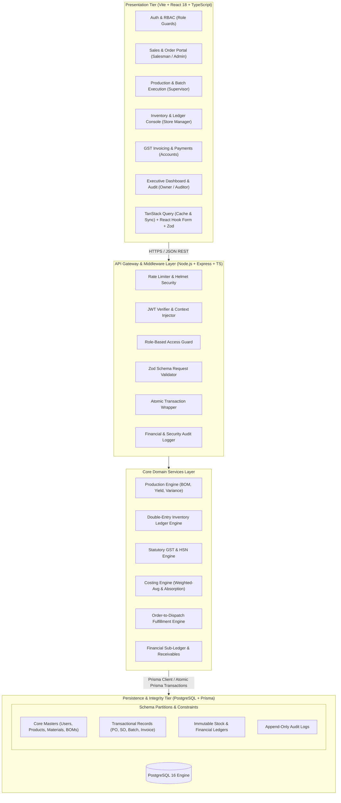
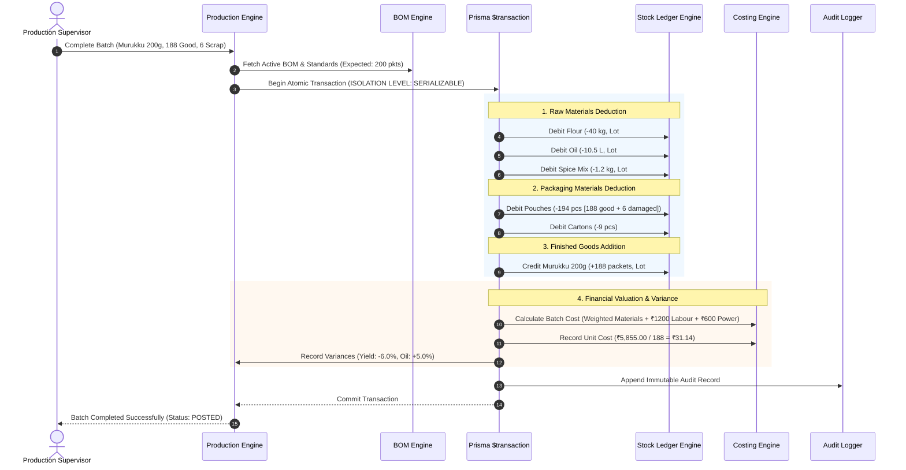

# SYSTEM ARCHITECTURE SPECIFICATION
## FactoryFlow ERP / Stockledger

### 1. High-Level System Architecture Diagram

---

### 2. Dual-Engine Architecture: Production & Inventory

The central technical differentiator of this ERP is the **Ledger-Based Inventory Model** operating under strict ACID guarantees:

---

### 3. Key Non-Negotiable Architecture Rules

1. **Immutable Stock Ledger**: Stock levels are never updated with simple `UPDATE items SET quantity = quantity - x`. Instead, every movement inserts an immutable row into `stock_ledger`. The current stock balance is either dynamically summed or maintained in a strictly synchronized projection table with optimistic locking (`version` column).
2. **Deterministic Financial Arithmetic**: All monetary quantities and fractional weights are stored with explicit scale:
   - Money: `Decimal(14, 2)` (or integer paisa equivalent)
   - Quantities & UOM rates: `Decimal(12, 4)`
   - Floating point arithmetic is strictly forbidden in calculations.
3. **Optimistic & Pessimistic Concurrency**:
   - Stock allocations during concurrent order placement acquire pessimistic row locks (`SELECT FOR UPDATE`) or optimistic version checks to prevent race condition overselling.
4. **Statutory Tax Engine**:
   - Intra-state transaction (Supplier/Factory in Tamil Nadu -> Customer in Tamil Nadu): Splits into equal CGST (2.5%) and SGST (2.5%).
   - Inter-state transaction: IGST (5.0%).
   - Rounding conforms to Indian GST Rule 54 (half-up rounding to nearest rupee on total invoice, exact two decimals on itemized line totals).
